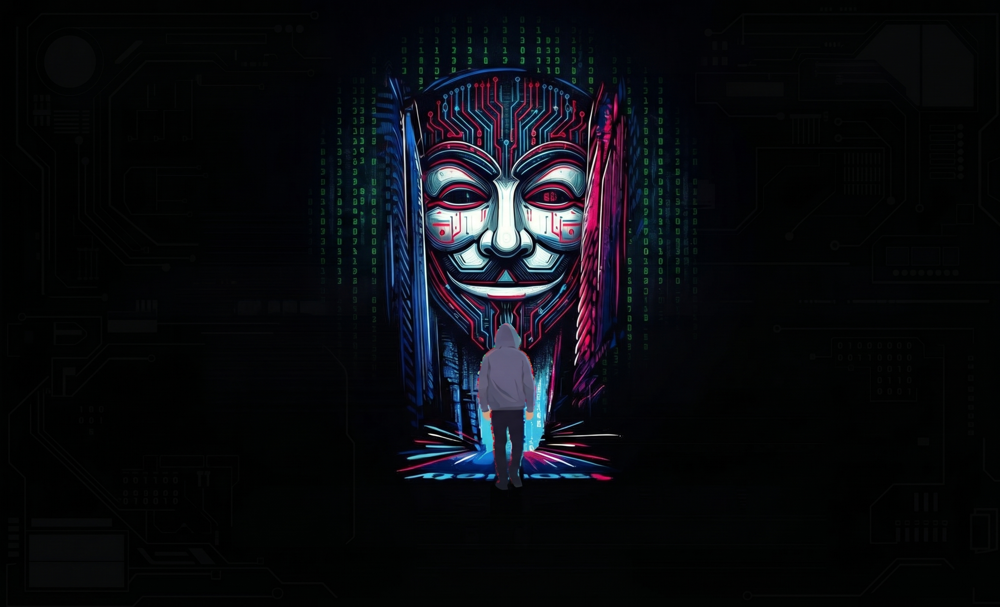

## Hamza@Root:~$ whoami

My name is Hamza, and I’m an aspiring Cybersecurity Analyst with a strong interest in Blue Team operations, SOC, and Threat Detection.

My main focus lies in Network Security, SIEM solutions, Security Monitoring, Incident Response, and Windows Infrastructure. I also enjoy hands-on lab projects, exploring cybersecurity tools, and learning through practical challenges.

This page will be a place to share my learning experiences, projects, and research. I hope you find something useful along the way!

Feedback and knowledge sharing are always welcome.

Cheers!

Hamza
